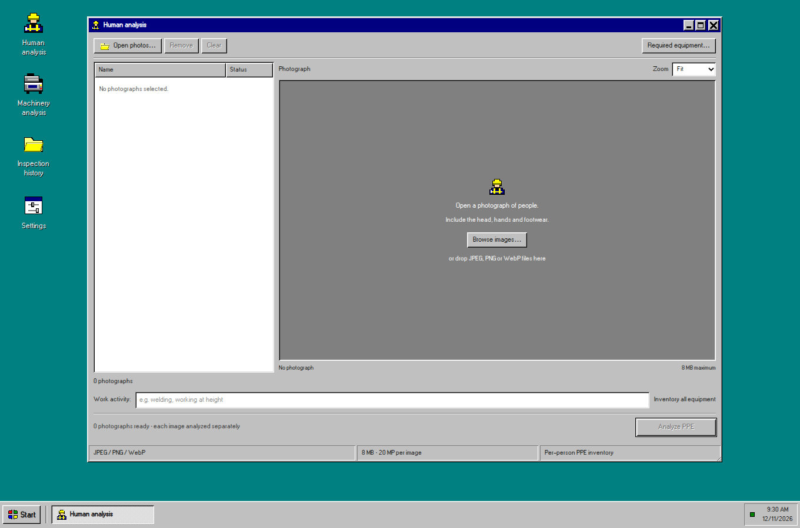
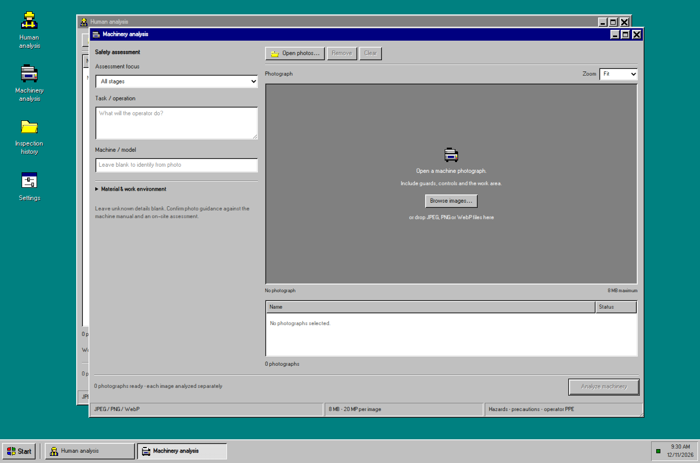

# SafeSight

**A visual workspace for PPE inspection and machinery safety review.**

SafeSight turns workplace photographs into structured equipment inventories and preliminary machinery assessments. Inspect visible PPE, check task requirements, review potential hazards, and keep a searchable record of each assessment—all within a Windows 95-inspired desktop interface.



[Getting started](#getting-started) · [Features](#features) · [Architecture](docs/ARCHITECTURE.md) · [Documentation](#documentation)

## Features

- **Human analysis** — identify each visible person's PPE, workwear, and carried equipment, with evidence and uncertainty recorded separately.
- **Equipment checklists** — check selected requirements or inventory all visible equipment without a predefined list.
- **Machinery analysis** — assess machine identity, visible and typical hazards, operator PPE, and precautions for operation, maintenance, and emergencies.
- **Inspection history** — search saved assessments, track processing status, and revisit the original photograph and results.
- **Reports and reanalysis** — download JSON, export history as CSV, print an assessment, or create a new analysis while retaining the earlier record.
- **Desktop workspace** — move, resize, minimize, and switch between independent windows; use the same tools on smaller screens.

<details>
<summary>Preview the machinery workspace</summary>



</details>

## Getting started

### Prerequisites

| Tool    | Version / requirement              |
| ------- | ---------------------------------- |
| Node.js | 24.21.0, as pinned in `.nvmrc`     |
| pnpm    | 12.8.1                             |
| Python  | 3.14 with `venv` and `pip`         |
| Docker  | Running engine with Docker Compose |

Use Linux, macOS, or WSL on Windows. Run the following commands from a Bash-compatible terminal.

### 1. Install and initialize

```bash
git clone https://github.com/abhilashbatthula/SafeSight.git
cd SafeSight
npm install -g pnpm@12.8.1
pnpm setup:dev
```

If you downloaded a source archive, extract it and start with the installation commands from inside its `SafeSight` directory.

Setup installs dependencies, creates local configuration with generated credentials, starts PostgreSQL, applies migrations, and initializes the workspace. Existing configuration and saved records are preserved.

### 2. Configure image analysis

Create a key in [Google AI Studio](https://aistudio.google.com/apikey) and set it in the generated `.env` file:

```dotenv
GEMINI_API_KEY=your_api_key
GEMINI_MODEL=gemini-3.1-flash-lite
```

The key stays on the server. API access, quotas, pricing, and data-use terms depend on your Google project; see [configuration](docs/CONFIGURATION.md) before submitting photographs.

### 3. Start the application

```bash
pnpm dev
```

Open **[localhost:8080](http://localhost:8080)**. This address serves the interface and API through the same-origin proxy. Use **Ctrl+C** to stop the application; PostgreSQL data remains in its Docker volume.

## Using SafeSight

1. Open **Human analysis** or **Machinery analysis** from the desktop.
2. Select JPEG, PNG, or WebP photographs. Each file can be up to 8 MB and 20 megapixels.
3. Add relevant task context. For human inspections, optionally choose required equipment.
4. Run the analysis, review the findings, and save or print the report. Each photograph has its own persistent inspection record.

Results distinguish observations from uncertainty. Machinery guidance and recommended operator PPE are separate from equipment observed on a person.

## Technology

| Layer                | Implementation                                                      |
| -------------------- | ------------------------------------------------------------------- |
| Interface            | Next.js, React, TypeScript, Tailwind CSS, TanStack Query            |
| API and jobs         | NestJS, Express, persistent PostgreSQL-backed worker                |
| Data                 | PostgreSQL, Drizzle ORM and versioned SQL migrations                |
| Image analysis       | FastAPI, Pydantic, Pillow, Google Gemini                            |
| Storage and delivery | Private local image storage, optional Cloudinary, same-origin proxy |

See the [architecture guide](docs/ARCHITECTURE.md) for the request flow, job lifecycle, and repository structure.

## Development

```bash
pnpm lint          # ESLint and formatting
pnpm typecheck     # Workspace TypeScript checks
pnpm test:unit     # Contracts, inference adapter, and setup/publication checks
pnpm build         # Production builds
pnpm check:secrets # Repository, history, and frontend/log checks
```

The unit suite needs installed Node/Python dependencies and a `DATABASE_URL` value; it does not connect to a database. API and browser suites use running services. [Development and testing](docs/DEVELOPMENT.md) includes the complete setup, local provider fixtures, and source packaging instructions. GitHub Actions runs the static checks, unit suite, and production build.

## Documentation

- [Architecture](docs/ARCHITECTURE.md) — components, data flow, and repository layout.
- [Configuration](docs/CONFIGURATION.md) — environment variables, provider setup, and image handling.
- [API reference](docs/API.md) — sessions, endpoints, input limits, and result formats.
- [Development and testing](docs/DEVELOPMENT.md) — local workflows, verification, and troubleshooting.
- [Deployment](docs/DEPLOYMENT.md) — Docker startup, persistence, and operating boundaries.
- [Third-party notices](docs/THIRD_PARTY.md) — dependencies and bundled font attribution.

## Scope and limitations

SafeSight supports human review. A photograph cannot establish hidden PPE, equipment certification, every machinery hazard, or workplace compliance. Confirm findings against the task, manufacturer instructions, and a competent safety assessment.

The application uses a shared workspace with anonymous sessions. Anyone who can reach the application can access that workspace; use an appropriate access boundary when deploying it. See [deployment](docs/DEPLOYMENT.md) for details.
