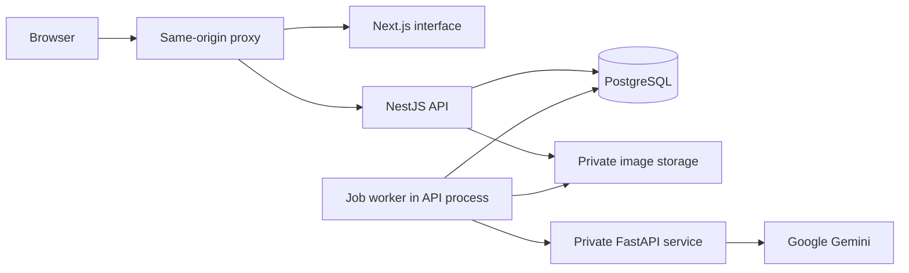

# Architecture

SafeSight is a TypeScript monorepo with a private Python inference service. The browser uses a single origin for the interface, API, images, and event stream.



## Inspection lifecycle

1. The API validates file signatures, dimensions, checklist, task context, and workspace scope. Sharp rotates the photograph, composites transparency onto white, removes metadata, and saves a normalized PNG.
2. A transaction creates the inspection and its persistent job. The initial status is `QUEUED`.
3. The worker claims an available job using `FOR UPDATE SKIP LOCKED` and marks it `PROCESSING`. A session advisory lock permits one API worker instance.
4. FastAPI authenticates the internal request, bounds the provider image to 2048 pixels on its longest side, and requests structured Gemini output.
5. Pydantic validates the provider response. The worker validates the shared Zod contract, image dimensions, required-item coverage, and person/machine references before persisting results.
6. The inspection becomes `COMPLETED` or `FAILED`. Server events and job-specific polling update the interface.

Failures remain explicit. A failed inspection can be retried up to three total attempts. Abandoned processing leases are reclaimed after two minutes. The provider request timeout is 75 seconds; the worker request timeout is 95 seconds. There is no automatic provider or synthetic-result fallback.

## Results and evidence

Human findings separate worn, carried, and uncertain equipment. Required-item checks distinguish observed, not observed, and uncertain items. Machinery results separate identity certainty, visible/typical hazards, phased precautions, and conditional operator wearables. Validators reject duplicate machine references and unconditional glove recommendations for flagged entanglement risks.

Reanalysis copies the retained image into a new inspection. Photo deletion preserves saved results and review history. Reviews append observations through the API without replacing the original model result. JSON, CSV, and print views provide different export surfaces.

## Client state

The desktop lives in the shared root layout. A window registry controls focus, position, size, minimize/maximize state, and routing. Forms and selected uploads survive window switching and minimizing. Closing a window discards its unsaved local state; persisted inspections remain in History. TanStack Query manages server state and terminal-job polling.

## Request protection

Opening the workspace creates an anonymous, 24-hour HttpOnly cookie session. Stored session tokens are hashed. Mutations require the matching origin and session CSRF token; queries enforce facility boundaries. Images are served through the API. These controls protect requests but do not authenticate individual users. Deployment access control remains an operator responsibility.

## Repository structure

```text
apps/
  api/                 REST endpoints, storage adapters, job worker
  web/                 Desktop interface, forms, results, local fonts/cursors
packages/
  contracts/           Shared TypeScript types and Zod schemas
  db/                  Drizzle schema and full SQL migration history
services/inference/    FastAPI service, Gemini adapter, Python tests
infra/                 Dockerfiles, Compose definitions, Nginx proxy
scripts/               Setup, initialization, checks, source packaging
tests/                 Contract, API, browser, and explicit provider fixtures
docs/                  Usage/technical documentation and interface previews
```

All migrations and snapshots are required source files. Historical tables and result formats remain for compatibility with existing installations.

[Back to README](../README.md)
