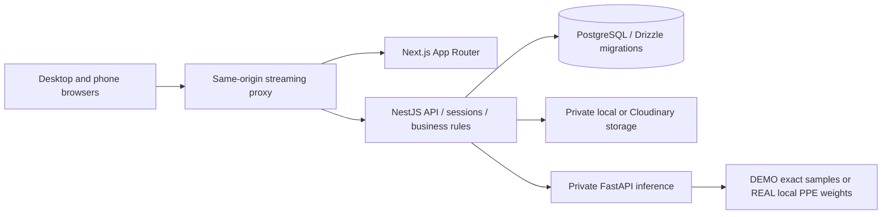

# SafeSight architecture

SafeSight is a single-instance educational decision-support prototype. It has no sensors or industrial cameras. Environmental observations always originate in a central simulator; inspections are image snapshots.

## Boundaries and contracts

`packages/contracts` contains version 1 public TypeScript contracts and Zod mutation schemas. It contains no server configuration. `packages/db` is backend-only. Drizzle defines the schema, generates tracked SQL migrations and performs seed inserts; parameterized PostgreSQL queries handle locking, aggregate history and business transactions in NestJS. Python only validates its private caller and runs inference / geometric association. Browsers call `/api`; they never receive database credentials, Cloudinary credentials, storage paths or inference keys.

The Next application uses React Query for authoritative fetches and invalidation, React Hook Form with Zod for login validation, shadcn/ui registry components, Tailwind 4 and Recharts. The same responsive application serves staff and guests. Routes are App Router catch-all entries with explicit operational views, loading/error states and guarded actions.

## Data

15 tables: users, facilities, memberships, sessions, zones, readings, simulation_runs, rules, inspections, jobs, detections, reviews, alerts, alert_actions and share_links. UUID references, UTC timestamptz, role/status constraints, lookup indexes and database partial unique indexes protect one current simulation run and one active condition per zone/key. Drizzle's migration journal supports idempotent migrations; seed uses conflict-safe inserts. Local reset is separate, scoped, explicitly confirmed and unavailable outside development.

Raw readings retain seven days; queries downsample to 15 seconds / 5 minutes / 1 hour and cap output. Raw API lists are paginated. UTC CSV exports cap at 10,000 rows, honor zone/time filters and neutralize spreadsheet formulas. Review percentages use the latest human review of each inspection in the last seven days. The denominator includes all reviewed persons, including unknown; unreviewed inspections are reported separately. No person detections means no compliance conclusion.

## Simulator and rules

A PostgreSQL session advisory lock prevents two API instances from owning the simulator/worker. One five-second generator starts independently of browser connections. It commits every zone tick before publishing SSE invalidation events. Scenario state, seed, tick counter, readings, condition counters and incidents persist in PostgreSQL. No browser creates readings.

Temperature/AQI rules require configured consecutive breaches. Recovery requires configured consecutive readings below threshold minus hysteresis. Stale rules evaluate age in seconds independently. Condition state is separate from OPEN → ACKNOWLEDGED → RESOLVED incident workflow. Active conditions require an explicit audited override to resolve. The partial unique condition index deduplicates concurrent openings. A recovered condition ends its active row but preserves workflow history. Disabling a rule ends the condition while retaining its incident. PPE conditions are snapshot findings; review confirms or corrects them.

## Inspection worker

Uploads validate magic bytes, decode only supported JPEG/PNG/WebP, limit 8MB / 20MP / minimum 32×32, reject animation, normalize EXIF orientation and store a PNG privately. A transaction inserts QUEUED inspection and job; upload returns immediately. The single worker atomically claims jobs using FOR UPDATE SKIP LOCKED, commits PROCESSING, sends trusted bytes with a private key and 60-second timeout, then commits COMPLETED or FAILED. Abandoned two-minute claims recover to QUEUED or FAILED; attempts cap at three. Failures require controlled manual retry. This is a single-process/single-worker assignment deployment, not a distributed job platform.

The original model result is immutable; reviews append corrections and notes with reviewer and time. Model/person boxes remain aligned to normalized source dimensions using an SVG viewBox above a responsive image. Person labels are local image references, not identities. Image deletion retains results and audit trail.

## Security and live access

Scrypt password hashes, random session tokens stored only as SHA-256 hashes, HttpOnly SameSite=Lax cookies, HTTPS Secure cookies, eight-hour sessions, same-origin checks plus session-bound X-CSRF-Token for mutations, and login/upload rate limiting. Facility membership is queried on every authenticated request. Backend roles protect administrative/review actions. Images, exports, SSE and guest links enforce scope.

SSE sends ready, change and five-second heartbeats with no buffering. Every event/heartbeat revalidates session and guest expiry/revocation. Disconnect removes listeners/timers. EventSource reconnect triggers a fresh snapshot/history fetch, not event replay; outage fallback periodically fetches authoritative data. Local proxy forwards Next development WebSockets as well as HTTP/SSE. Nginx provides the full Compose streaming proxy.

Guest links store only random-token hashes. Tokens appear in a fragment (not request paths or referrers), are removed before exchange, then become an expiring scoped cookie session. Guests cannot mutate, export, administer or see images unless allowed. Staff QR codes contain only a configured reachable facility/zone URL. Localhost codes are rejected.

## Deliberate limitations

No production-readiness or occupational-safety certification is claimed. No optional outdoor weather/AQI or PDF reports; zone AQI is always simulated US AQI. The optional REAL/Cloudinary integrations require external configuration and independent verification. Physical phone scanning and actual LAN reachability require manual validation. Multi-instance scaling would need a fuller worker lease / durable event system, and production account onboarding, secret management, retention policies and operational hardening are outside this college prototype.
